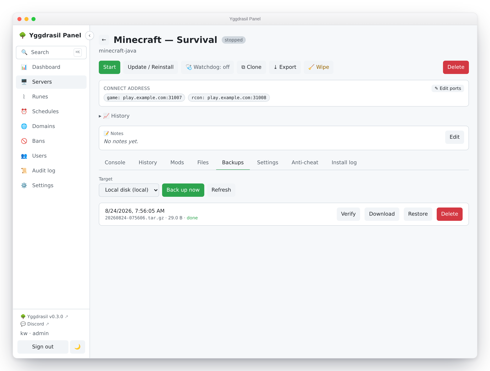
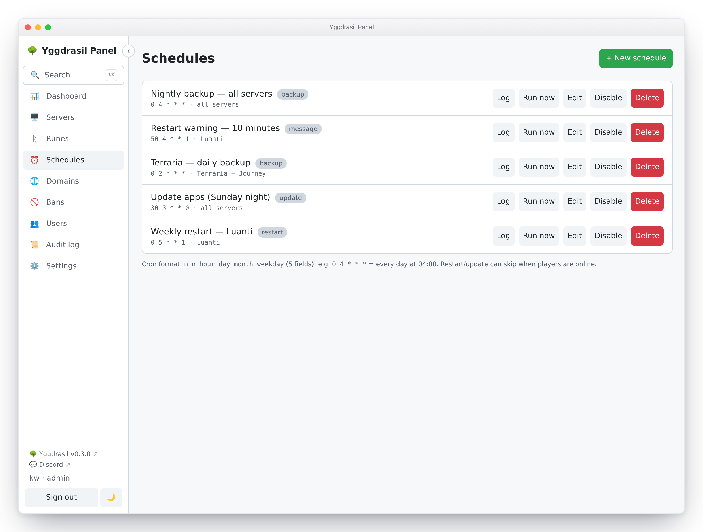

# Backups and schedules

Where backups go, what is actually in them, how to prove one is restorable, and how to
put any of it — plus restarts, updates and in-game warnings — on a cron schedule.

## Backup targets

A **target** is a place archives are stored. Admins configure them under
**Settings → Integrations → Backup targets**; there are eight kinds.

| Type | UI label | What it is |
| --- | --- | --- |
| `local` | Local / NFS / CIFS mount | A directory on the host. Also the right choice for an NFS or CIFS share you have already mounted — point the path at the mountpoint. |
| `sftp` | SFTP | An SFTP server, reached over SSH with a username and password. Port defaults to 22. |
| `smb` | SMB / CIFS (direct) | An SMB2 share, spoken natively with no host mount. Needs a share name. Port defaults to 445. |
| `pbs` | Proxmox Backup Server | An existing PBS you already run. Deduplicated, incremental snapshots instead of nightly full archives. Port defaults to 8007. [Its own section below.](#proxmox-backup-server) |
| `s3` | Amazon S3 / S3-compatible | A bucket on Amazon S3, or on anything that speaks its API: Cloudflare R2, Backblaze B2, Wasabi, DigitalOcean Spaces, Hetzner, MinIO. [Cloud storage below.](#cloud-storage) |
| `gcs` | Google Cloud Storage | A bucket on Google Cloud, reached with a service-account key. |
| `azure` | Azure Blob Storage | A container in an Azure storage account, reached with its access key or a SAS token. |
| `rclone` | Cloud drive | Jottacloud, Dropbox, OneDrive, Google Drive, Box, pCloud, Mega or a WebDAV server such as Nextcloud — or any other service rclone supports. [Cloud drives below.](#cloud-drives) |

Choose **+ New target**, name it, pick the type, and fill in what it asks for. Local
wants a directory path (`/mnt/backups`); Yggdrasil creates it if it does not exist. SFTP
and SMB want a host, optional port, username and password, plus a remote path — relative
to the login directory for SFTP, and to the share root for SMB. SMB also wants the share
name.

Then use **Test**. It opens the target and lists it, which catches the whole chain —
DNS, port, credentials, share name, permissions — before a backup depends on it. A
failure comes back with the underlying error rather than a shrug.

Target credentials are encrypted at rest with AES-256-GCM, keyed from the panel's secret.
The target list decrypts only enough to show you the path and host; passwords are never
sent back to the browser and never logged.

Two things to know about the SFTP target: it authenticates with a password (not a key),
and it does not pin the host key. It suits a homelab NAS on your own network.

## Cloud storage

The three cloud targets store the same gzipped tar as local, SFTP and SMB, as one object
per run, under `<folder>/<server-name>-<id>/<timestamp>.tar.gz`. The folder is optional;
leave it empty to write at the top of the bucket. **Create the bucket (or container)
first** — Yggdrasil never creates one, so a typo fails the Test instead of quietly making
a new bucket somewhere you are paying for.

The archive streams to the provider while it is being made, so nothing is written to the
panel's disk on the way. It goes up in chunks — 64 MiB for S3, 16 MiB for Google and Azure —
and one chunk at a time is held in memory. The chunk sizes put a ceiling on a single
archive: 640 GB on S3, 800 GB on Azure, and Google's own limit of 5 TB per object.

**Amazon S3 and compatibles.** Bucket, region, access key ID and secret access key. Leave
the endpoint empty for AWS itself; for anything else, the endpoint is the provider's S3
host:

| Provider | Endpoint | Region |
| --- | --- | --- |
| Cloudflare R2 | `<account-id>.r2.cloudflarestorage.com` | `auto` |
| Backblaze B2 | `s3.<region>.backblazeb2.com` | the region in the endpoint |
| Wasabi | `s3.<region>.wasabisys.com` | the region in the endpoint |
| DigitalOcean Spaces | `<region>.digitaloceanspaces.com` | the region in the endpoint |
| Hetzner Object Storage | `<region>.your-objectstorage.com` | the region in the endpoint |
| MinIO on your network | `http://192.168.1.10:9000` | `us-east-1` unless you changed it |

An endpoint without `http://` is reached over HTTPS. Give the key permission to list,
read, write and delete objects in that one bucket and nothing else — on AWS, an IAM policy
with `s3:ListBucket` on the bucket and `s3:GetObject`, `s3:PutObject`, `s3:DeleteObject`
on its objects.

**Google Cloud Storage.** In the Google Cloud console create a service account, give it
the **Storage Object Admin** role on the bucket (not the project), then
**Keys → Add key → JSON**, and paste the whole downloaded file into the key field. The
key is stored encrypted like every other target secret. Google's S3-compatible endpoint is
deliberately not used: it cannot take an upload whose size is unknown when it starts,
which is exactly what a streamed archive is.

**Azure Blob Storage.** The storage account name, the container, and either the
account's access key (**Security + networking → Access keys**) or a SAS token. A SAS
token needs read, write, delete and list permission on the container, and stops working
the day it expires — the Test button will tell you, but a schedule will only tell you by
failing. The access key does not expire. The endpoint field is for Azure's government and
China clouds; leave it empty otherwise.

## Cloud drives

The consumer cloud services do not speak S3 and each has its own API, so Yggdrasil
reaches them through [rclone](https://rclone.org), run in a short-lived container the
same way the PBS client is (image `rclone/rclone`, pinned to a version; override it with
`docker.rclone_image` in `config.yaml`). It stores the same tar.gz as every other file
target, under the optional folder. Pick **Cloud drive** as the type, then the service.

The login is set up once, when you save the target. Yggdrasil runs rclone's own
configuration and keeps the result — an `rclone.conf` with one remote — encrypted with
the target. Services that log in with OAuth hand out tokens that expire within the hour;
rclone renews them as it goes, and the panel saves each renewed token back. The login is
never sent to the browser, and an edit with the credential field left blank keeps it.

**Jottacloud.** In Jottacloud, open **Settings → Security** and choose **Generate** under
*Personal login token*. Paste it and save. The token works **once**: the panel trades it
for a login of its own during the save, so if the save fails for any other reason, make a
new token. Backups land in Jottacloud's *Archive* section, in the folder you gave.
Jottacloud has no public API — rclone speaks the one Jottacloud's own apps use, which has
been stable for years but could change without notice; if it does, backups fail and say
so rather than going quiet.

**Dropbox, OneDrive, Google Drive, Box, pCloud.** These log in through a browser, so the
login happens on your own computer, not on the panel: install rclone, run
`rclone authorize "dropbox"` (or `onedrive`, `drive`, `box`, `pcloud`), sign in, and paste
the token it prints — the JSON starting with `{"access_token"`. No app has to be
registered anywhere.

**Mega.** The account's e-mail address and password. An account with two-step login
cannot be used this way.

**WebDAV, Nextcloud, ownCloud.** The WebDAV address, the server type and a login. For
Nextcloud the address is `https://<host>/remote.php/dav/files/<user>`; use an app
password rather than the account's own.

**Anything else.** Choose *Other*, and paste one remote's section as
`rclone config show <name>` prints it. Every service rclone supports works this way.

Two things to know:

- **Most services want the whole file before they accept it** — a checksum or a size up
  front. For those rclone writes the archive to a temporary file inside its container (on
  the panel host's Docker storage) before uploading, so that disk needs room for the
  largest backup. Dropbox and Box take the archive as a stream and need no room; Jottacloud,
  pCloud and WebDAV do, and so should be assumed of any other service.
- **Consumer accounts are for your own data.** Their terms are written for people, not for
  reselling storage; backing up your own servers is what they are for.

## Proxmox Backup Server

The other targets all store the same thing: one gzipped tar per run, written whole
every time. That is simple and it is fine — until the server is 40 GB and the schedule is
nightly.

A **PBS target** works differently, and the difference is the entire point. Instead of
building an archive and uploading it, Yggdrasil hands the data directory to
`proxmox-backup-client`, which splits it into content-defined chunks and uploads only the
chunks your datastore does not already have. On a real 57 MB directory, measured:

| Run | Transferred |
| --- | --- |
| First backup | 57.5 MB |
| Again, nothing changed | **0 B** |
| After editing one small file | 8.2 MB |

Nightly backups of a large, mostly-static game world therefore cost close to nothing
after the first one, and every night is still a full restore point rather than an
increment that depends on the ones before it.

This connects to a PBS you already run. Yggdrasil does not host one.

### What you need on the PBS side

Create an API token — **Configuration → Access Control → API Tokens** — and note the
secret when it is shown. It is displayed once.

Then grant permissions, and read this part twice, because it is the thing that goes
wrong:

> **Give the role to BOTH the user and the token.** A token's effective permissions are
> the *intersection* of its own and its user's. Granting `DatastorePowerUser` to only the
> token leaves it with nothing, and the panel reports
> `permission check failed - missing Datastore.Audit|Datastore.Backup`, which reads like
> a wrong password.

> **Use `DatastorePowerUser`, not `DatastoreBackup`.** `DatastoreBackup` can write
> snapshots but cannot prune them, so retention silently never runs and the datastore
> grows without limit. If that happens, Yggdrasil warns on the server's notification
> channel — "Backup kept, but retention could not run" — rather than letting you find out
> when the disk fills.

If your PBS uses its own self-signed certificate (the default), you also need its
fingerprint. Get it from **Administration → Certificates**, or on the PBS host:

```
proxmox-backup-manager cert info | grep -i fingerprint
```

### Filling in the target

| Field | Example | Notes |
| --- | --- | --- |
| Host | `pbs.lan` | Hostname or IP, and it must resolve **from the panel's host**. IPv6 works; the panel brackets it for you. |
| Port | *(blank)* | Defaults to 8007. |
| Auth ID | `ygg@pbs!panel` | The **full** token id, including the `!name` part. |
| API token secret | *(from PBS)* | Encrypted at rest, never sent back to the browser. |
| Datastore | `backups` | The datastore name, not a path. |
| Namespace | *(blank)* | Optional. Empty means the datastore root. |
| Certificate fingerprint | `aa:bb:…` | Required for self-signed certificates. |

Then use **Test**. It lists the datastore's backup groups, which exercises DNS, TLS, the
fingerprint, the auth id, the token secret and the datastore name in one call — so a
green result means a backup will reach the same place. Use it before attaching a schedule;
it fails in seconds where a backup fails after the container has started.

One name to be careful with: on a **Tailscale** network, a `*.ts.net` MagicDNS name only
resolves if MagicDNS is actually enabled on the panel's host. If it is not, the backup
fails with `dns error: no record found` — which reads like the PBS server is down. The
Tailscale IP (`100.x.y.z`) always works, and the panel reaches it from inside the backup
container the same way it reaches any other address.

### How snapshots are named

Each panel server gets its own PBS backup group, `host/<server-name>-<short-id>`. The
group is what makes the deduplication work: a snapshot is compared against the previous
snapshot *in the same group*.

One consequence worth knowing: **renaming a server starts a new group.** The old
snapshots stay where they are and remain restorable from PBS directly, but the next
backup has nothing to dedupe against and transfers everything once.

### What is different from the other targets

- **Retention runs on the PBS server.** "Keep latest N" becomes `--keep-last`, exactly.
  "Keep days" becomes `--keep-daily`, which keeps the newest snapshot of each of that
  many days *that have one* — not a rolling window of calendar days. With one backup a
  day the two are the same thing; with several a day they are not.
- **Deleting a snapshot does not free space immediately.** Chunks are shared between
  snapshots, so nothing can be reclaimed until the PBS server runs garbage collection.
- **Verify is PBS's job.** The panel's own verify re-reads a tar; for PBS, run a Verify
  job on the datastore, which checks the stored chunk checksums properly.
- **Download is not offered.** A snapshot is deduplicated chunks plus an index, not a
  file, so there is nothing to hand a browser. Restore it to the server, or use
  `proxmox-backup-client` against your PBS directly.
- **Restore writes in place** over the running server's data directory, after stopping
  the container — same as the other targets.
- **A `.pxarexclude-cli` file appears** in a restored directory when the rune limits the
  backup to certain paths. It is the client's own record of what was excluded, and it is
  harmless.

### Requirements

The panel host must be **amd64**. Proxmox publishes the backup client for amd64 only, so
a Raspberry Pi panel cannot use a PBS target; it will say so rather than failing at the
first backup.

The client itself runs in a small container the panel pulls once
(`ghcr.io/kristianwind/yggdrasil-pbs-client`), so there is nothing to install on the
host. On a network that cannot reach GHCR, mirror it and set `docker.pbs_client_image` in
the panel's config.

## What a backup contains

A backup archives the server's data directory — the volume mounted at `/data` in the
container.

Which parts, exactly, is the rune's business. A rune (the code and API call it a
`gameskill`) may carry a `backup` block naming the paths worth keeping, relative to
`/data`:

```yaml
backup:
  include: ["world", "world_nether", "world_the_end", "server.properties", "plugins"]
```

**When `backup.include` is absent, the whole data directory is archived.** When it is
present, only those top-level paths are — an included path that does not exist on disk is
skipped rather than failing the run. Paths are stored relative to the data directory, so
an archive restores cleanly into a fresh install.

Only regular files and symlinks go in. Sockets and device nodes are skipped.

Backups do not include the server's environment variables, port allocations, mods list or
any other panel-side state — that lives in Yggdrasil's database, not in `/data`. A backup
restores a world; it does not recreate a server.

## The archive format, stated plainly

A backup is a **plain gzip-compressed tar** — `.tar.gz`, nothing more. It is streamed
straight from the data directory to the target through a pipe, so a large world never
lands on the host as a temporary file.

**The archive itself is not encrypted.** Only *target credentials* are encrypted at rest.
Anyone who can read the target directory, share or SFTP account can read your world files,
your configs, and any secrets those configs contain. Set this expectation now, not during
an incident:

- Do not treat an untrusted or shared remote as safe for backups.
- If you need encryption at rest, it has to come from underneath — an encrypted
  filesystem, an encrypted volume on the NAS, or a target only you can reach.

The upside of a boring format is that you are never locked in. Any machine with `tar` can
open a Yggdrasil backup, with or without the panel:

```bash
tar -tzf 20260714-031500.tar.gz          # list what's inside
tar -xzf 20260714-031500.tar.gz -C ./out # extract it anywhere
```

## Naming and layout

Archives are stored under a readable folder per server rather than a bare UUID, so a
directory listing on the NAS means something:

```text
<server-name-slug>-<first 8 chars of server id>/<YYYYMMDD-HHMMSS>.tar.gz
```

For example `mc-survival-3f9a1c2b/20260714-031500.tar.gz`. The name is lowercased with
anything that is not a letter or digit collapsed to a single dash; the short ID keeps the
folder unique if two servers share a name. Timestamps are UTC.

Retention works off the database, not off directory listings, so this layout is safe to
browse, and safe to change in future.

## Running a backup

Open a server, go to the **Backups** tab, pick a target and choose **Back up now**. The
run is asynchronous: a row appears immediately as `pending`, moves to `running`, then
`done` (with the archive path and size) or `error` (with the reason). Either outcome
sends a notification — ✅ with the size, or ❌ with the error.

Running a backup needs `server.backup` on that server. See
[Users and permissions](users-and-permissions.md).

To cover several servers at once, use the checkboxes on the **Servers** list and the bulk
backup action: pick one target and it starts a backup for every selected server you have
`server.backup` on and that is installed.



## Restoring

On the **Backups** tab, **Restore** on a completed backup. Yggdrasil stops the container
first (with a 30-second grace period) so files are not swapped under a running game, marks
the server stopped, streams the archive from the target and extracts it over the data
directory. You start the server again yourself when you are ready.

Restore overwrites. Files in the archive replace files on disk; files not in the archive
are left alone. It is not a rollback to a point in time — it is an extraction on top of
whatever is there. If the current state matters, back up before restoring.

Extraction is guarded against archives that try to escape the data directory — worth
knowing about if you ever restore an archive you did not create:

- Any entry whose resolved path lands outside the destination is rejected outright.
- A symlink entry pointing outside the destination is rejected, so a later entry cannot be
  written *through* it onto host files.
- Regular files are opened with `O_NOFOLLOW`, so if the path already exists as a symlink
  the write fails rather than following it.

Any of these aborts the restore with an error, mid-way. An archive is not trusted on the
grounds that it came from your own target.

## Retention

Retention is per target, set when you create it, and applied after every successful backup
to that target.

- **Keep latest N** — keep the N newest backups. `0` disables the count rule.
- **Keep days** — keep anything newer than this many days. `0` disables the age rule.

The rules are OR'd: a backup survives if it is within the newest N **or** newer than the
day cutoff. Setting both is a floor plus a window — "keep at least the last 5, and
anything from the last 30 days". With both at `0` there is no policy and nothing is ever
deleted.

Retention deletes the archive from the target and the row from the panel, and it only ever
considers completed backups for that one server on that one target.

On a **Proxmox Backup Server** target the same two settings are applied by PBS's own
`prune`, which is chunk-aware; the panel then removes the rows for whatever PBS deleted,
so the list stays equal to what is actually restorable. The mapping and its one wrinkle
are in [Proxmox Backup Server](#proxmox-backup-server).

## Verify

**Verify** on a completed backup downloads the archive and streams it through gzip and tar
to `io.Discard` — reading every byte, writing nothing anywhere. It is a real integrity
check, not a size or timestamp comparison: a truncated archive, a flipped bit or a
half-written upload fails at the gzip CRC or on a short tar entry. On success you get the
file count and total uncompressed size; on failure you get the error that killed it.

This applies to the archive targets. A **Proxmox Backup Server** snapshot is verified by
PBS itself, against the chunk checksums it stored — a stronger check than re-reading a
tar, and one the panel would only duplicate badly. Run a Verify job on the datastore;
Yggdrasil's Verify button says so rather than pretending.

Verify writes nothing to disk and does not touch the server. Nothing stops you running it
on a live server mid-session.

The result is stored on the backup, and the list shows a badge next to it:

- **✓ verified** — the archive decompressed in full.
- **✗ corrupt** — it did not. Take a fresh backup.
- no badge — never verified. Unknown, not good.

A target that is unreachable is not a corruption verdict; that comes back as a fetch error
and leaves the badge alone.

### Nightly auto-verify

**Settings → Integrations → Backup verification** has one switch: *Verify the latest
backup of each server nightly*.

**It is off by default**, and deliberately so — it downloads each archive from its target,
which costs real bandwidth on a remote SFTP or SMB store — and, on cloud storage, real
money: most providers charge for data downloaded (egress). Turn it
on if your target is local or your link is cheap.

When on, the pass runs at most once per day and **only checks the newest completed backup
per server**, which keeps the cost bounded and predictable. A background loop wakes every
30 minutes and runs the pass if it has not run today, so a panel restart or a box that was
asleep at 3am catches up rather than skipping the day. The day is stamped before the pass
starts, so a slow pass cannot re-trigger itself.

If any of those newest backups is corrupt, you get one notification naming the affected
servers and their errors. A clean pass is silent. The panel shows the date of the last pass
it *started*, not the last one that finished: it reads the same stamp, so the date appears
the moment the pass begins.

Verifying only the newest backup is a deliberate trade. It answers "if I needed a backup
right now, would it work?" — not "is my whole history intact".

## The backup-coverage nudge

The **Dashboard** shows admins a warning when installed servers have no recent backup: *"N
servers have no recent backup"*, listing each one with how long ago its last backup was, or
*never*.

"Recent" means a successful backup within the last **7 days** by default. Only installed
servers count, and only backups that reached `done` — a server whose backups have been
failing for a week shows up here, which is the point. The card lists the servers by name
so you can go fix them. It disappears when everything is covered.

## Schedules

**Schedules** in the sidebar. A schedule is a cron expression, an action, a scope, and
some arguments.



### Cron

Standard 5-field cron (`min hour dom month dow`), or 6 fields to get a leading seconds
field. The editor rejects anything that is not 5 or 6 fields before saving; the full parse
happens when the schedule is registered. Times are the panel host's local time.

```text
0 4 * * *      every day at 04:00
0 */6 * * *    every six hours
30 3 * * 1     Mondays at 03:30
```

New schedules start enabled. **Disable** keeps the schedule but stops it firing; the cron
is rebuilt from the enabled schedules whenever anything changes.

### Scope

| Scope | Runs against |
| --- | --- |
| Server | That one server. |
| Realm | Every server in that realm, at the time it fires. |
| Global | Every server. |

Realm and global schedules pick up servers added later — that is the point of them, and
the thing to think twice about before scoping a `stop` globally.

Realm and global schedules are admin-only, to create and to see: a delegate's schedule
list only contains server-scoped schedules for servers they hold `server.schedule` on.

Some rows are managed by a per-server control (the auto-restart toggle writes one). Those
are hidden from the Schedules page on purpose, so they cannot be hand-edited into a state
the control does not expect.

### Actions

| Action | What it does |
| --- | --- |
| `backup` | Backs the server up to the chosen target. Same path as the Backups tab, retention included. |
| `restart` | Recreates the container and starts it — not a plain Docker restart, so rune, env and mod changes land too. Falls back to a plain restart if recreation fails. |
| `start` | Starts the existing container. Errors if the server has no container yet. |
| `stop` | Stops the container, 30-second grace. Skips if there is no container. |
| `command` | Sends a raw command over RCON, falling back to the container's stdin for games without it. |
| `message` | Renders a message template and sends it to players the same way. |
| `update` | Re-runs the install/update (SteamCMD and the like). Synchronous, so the run log reports the real outcome. |

The API also accepts a `wipe` action, which resets world/persistence as the rune defines
it and needs `server.control` like the Wipe button does. The schedule editor does not offer
it; wiping is normally done from a server's **Wipe** button, which asks for confirmation and
runs once, immediately.

A warned restart — optionally back up, broadcast the rune's countdown to players, then
recreate — is a server's **Safe restart** action rather than something the schedule editor
offers. The backup runs first, before the countdown starts, so the archive captures the
world as it stood when you pressed the button rather than at the end of the warning window.

A `restart` schedule can do the same via the API by passing `warn: "true"` in its
arguments; because the countdown blocks for minutes, that variant runs in the background
and the run log records it as started rather than finished.

### Message templates

`message` sends a template rather than free text, so the wording lives in one place.
Templates are edited under **Settings → Integrations → In-game message templates**, and
Yggdrasil seeds five on first boot: Restart warning, Restart countdown, Backup warning,
Maintenance notice, Update warning.

A template body is the full console/RCON command, so it works across game types — you tune
the syntax per game if you need to:

```text
say Server restarting in {{minutes}} minutes. Please find a safe spot.
```

`{{key}}` placeholders are substituted at send time. Three keys are substituted:
`{{server_name}}`, `{{minutes}}` and `{{seconds}}`.

The panel fills in `{{server_name}}` itself. For the rest, the schedule editor reads the
template you picked and gives you an input for each placeholder it uses — pick **Restart
countdown** and you're asked for a `{{seconds}}` value; pick **Backup warning**, which
uses only the server name, and you're asked for nothing. The body is shown under the
picker so you can see what you're filling in.

A placeholder nothing fills in is left in the text untouched, and a template still
holding one at send time is **not** sent: the run log records
`error — template needs a value for {{seconds}}` instead. A message going out to your
players with a gap where a number should be is worse than one that doesn't go out, and
the run log is where you find out why.

### Warning players before a scheduled restart

`restart` offers **warn players with the in-game countdown first**, on by default. It runs
the same safe-restart path as the button on the server page: Yggdrasil broadcasts the
rune's `restart.warnings` countdown in-game, waits it out, and then restarts. The run log
records `warned restart initiated` when the countdown starts, because the countdown
outlives the run itself.

A game whose rune declares no countdown has nothing to broadcast, so it restarts straight
away — the setting costs nothing there, but it buys nothing either. A schedule scoped to a
realm or to all servers can span both kinds.

Untick it for a restart that should happen immediately and unannounced. That is the right
choice at 04:00 on an empty server, and the wrong one at 20:00.

### Skipping when players are online

`restart` and `update` offer **skip if players are online**. When it is on, Yggdrasil
queries the server's player count before acting and skips if anyone is connected; the run
log records `skipped — players online`.

This needs the rune to define a query protocol. If the count cannot be determined the
action goes ahead — an unanswerable query is not treated as "players online". Do not lean
on this as a safety interlock on a game Yggdrasil cannot query.

### Run history

**Log** on a schedule shows its recent runs: when it fired, which server, the action, the
status and a detail string. The panel keeps the last 100 runs per schedule and shows the
50 most recent.

Every firing records **one row per target server**, so a realm-scoped backup across six
servers writes six rows. Status is one of:

- `ok` — done, with a detail like `restarted` or `backup completed`.
- `skipped` — deliberately not done: players online, no command configured, already
  stopped.
- `error` — tried and failed, with the reason.

A scheduled **backup** runs synchronously and reports its real outcome, so `ok` here means
the archive reached the target and `error` carries the reason it didn't. That makes the run
log a usable answer to "did last night's backups actually run?" — you don't have to
cross-check every server's Backups tab.

A **warned restart** is the one action that reports what it started rather than what it
finished: the countdown runs for minutes in the background, so the row says `warned restart
initiated` as soon as the warning goes out.

A firing that matches no servers records a single `skipped` row with `no servers in scope`.

**Run now** fires a schedule immediately, ignoring its cron time. It is the way to test one
without waiting for 4am.

### One notification per firing

A firing sends **one** summary notification, not one per server:

```text
✅ Schedule "nightly-restart" (restart): 5 ok, 1 skipped, 0 failed
  ok: alpha, beta, gamma, delta, epsilon
  skipped: zeta (players online)
```

The icon is ✅ when everything worked, ❌ if anything failed, ⏰ if nothing ran.

Only state-changing actions notify: `start`, `stop`, `restart` and `update`. Backups stay
quiet at the schedule level because `runBackup` already emits its own ✅/❌ per server, and
`message` and `command` are in-game only — announcing them to your phone would be noise.
See [Notifications](notifications.md) for wiring up channels.

## Who can do what with schedules

Creating a schedule needs `server.schedule` on the target server, **plus the scheduled
action's own permission** — so a Schedule grant cannot be escalated into powers the
delegate does not otherwise have:

| Action | Extra permission needed |
| --- | --- |
| `command` | `server.console` |
| `start`, `stop`, `restart`, `update` | `server.control` |
| `wipe` | `server.control` |
| `backup` | `server.backup` |
| `message` | none beyond `server.schedule` |

Each action's requirement matches the gate on the equivalent direct endpoint, so scheduling
something never grants more than doing it by hand would. The table is exhaustive and fails
closed: an action with no entry is rejected rather than waved through, and a test asserts
every known action appears here — a new action cannot reach the scheduler ungated.

Admins skip this check, as they skip all of them.

There is an asymmetry here worth knowing before you hand out `server.schedule`:

**Update, delete and run-now are admin-only.** Not permission-checked — admin-only, flatly.
A delegate with `server.schedule` on a server can *create* a schedule there and read its
run log, but cannot then edit it, disable it, delete it, or trigger it. Once created, it is
yours to manage.

The practical consequences:

- A delegate who mistypes a cron expression cannot fix it. They need an admin, or a second
  schedule.
- A delegate cannot turn off a schedule they created — not even their own runaway one.
- `server.schedule` is closer to "may propose recurring work" than "may manage schedules".

If you want someone to own schedules end to end, they need to be an admin. If you want them
to have no say, do not grant `server.schedule`.

## See also

- [Users and permissions](users-and-permissions.md)
- [Servers](servers.md)
- [Notifications](notifications.md)
- [Monitoring and alerts](monitoring-and-alerts.md)
- [API reference](../reference/api.md)
